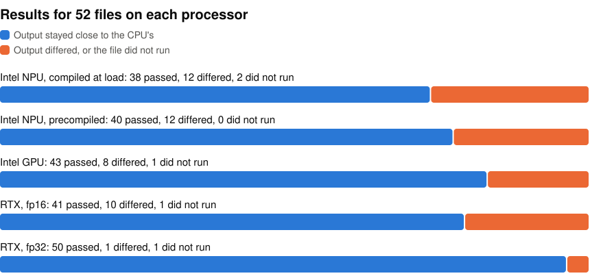

# Vision and audio models on one Windows PC

I ran 52 vision and audio ONNX files on every processor of one Windows laptop in November 2026, to see which processors can run each model and how long it takes.

<picture>
  <source media="(prefers-color-scheme: dark)" srcset="https://raw.githubusercontent.com/john-rocky/windows-zoo/main/docs/images/results-dark.svg">
  
</picture>

A result passes when every output has a cosine similarity of at least 0.99 with the CPU's fp32 output and contains no NaN or Inf. Class scores must also keep at least 99 % of their top-1 answers. I compared raw outputs, not the final images or transcripts.

A pass only means the processor agreed with the CPU on the same file. tf2onnx 1.17.0 lost FULLY_CONNECTED biases in 13 of the 52 files, and the CPU runs those same files, so this check can't see it. I found it by comparing each file with its `.tflite`. The chart counts the original 52. I converted those 13 again with a one-line fix (`convert/patch_tf2onnx.py`), measured them as `<model>_fixed` and uploaded the fixed files to Hugging Face.

The 13 are the rows under [The 13 fixed files](RESULTS_WINDOWS.md#the-13-fixed-files). On Hugging Face each fixed file keeps its plain name (`<model>.onnx`) in one of these 10 repos: [D-FINE-S](https://huggingface.co/mlboydaisuke/D-FINE-S-OpenVINO), [RF-DETR-Nano](https://huggingface.co/mlboydaisuke/RF-DETR-Nano-OpenVINO), [RT-DETRv2-S](https://huggingface.co/mlboydaisuke/RT-DETRv2-S-OpenVINO), [Depth-Anything-3-Small](https://huggingface.co/mlboydaisuke/Depth-Anything-3-Small-OpenVINO), [Metric3D-v2](https://huggingface.co/mlboydaisuke/Metric3D-v2-OpenVINO), [SAM2-hiera-tiny](https://huggingface.co/mlboydaisuke/SAM2-hiera-tiny-OpenVINO), [L2CS-Gaze360](https://huggingface.co/mlboydaisuke/L2CS-Gaze360-OpenVINO), [PP-OCRv5](https://huggingface.co/mlboydaisuke/PP-OCRv5-OpenVINO), [Places365-ResNet18](https://huggingface.co/mlboydaisuke/Places365-ResNet18-OpenVINO) and [wav2vec2-keyword-spotting](https://huggingface.co/mlboydaisuke/wav2vec2-keyword-spotting-OpenVINO).

- **Models:** 52 ONNX files converted from the `.tflite` models of the [LiteRT zoo](https://github.com/john-rocky/LiteRT-Models), including RF-DETR, D-FINE, SAM2, Depth Anything 3, RTMPose and PP-OCR. A few models are two files, such as a detector's encoder and decoder.
- **Runtimes:** ONNX Runtime 1.31.1 with its CPU, CUDA and OpenVINO providers, and OpenVINO 2026.4.1
- **Processors:** the CPU, Intel GPU and Intel NPU of a Core Ultra 9 386H, and an RTX 5080 Laptop GPU at its 95 W limit
- **PC:** MSI Stealth 16 AI+, 31.5 GB of memory, Windows 11 Home

## Look up a result

[RESULTS_WINDOWS.md](RESULTS_WINDOWS.md) has one row per file, with its times, load times and whether it passed. For example, the cloth segmentation model `clothseg` takes 36.55 ms on the RTX in fp16, 62.59 ms on the Intel GPU and 2,046 ms on the CPU. On the Intel NPU it takes 94.22 ms from a precompiled blob that loads in 0.08 s. Compiling the plain ONNX file at load takes 396 s.

The table also has Snapdragon X2 Elite and Galaxy S26 columns from earlier runs on Qualcomm AI Hub. For the error text of anything that did not run, see the JSON files in [`results/`](results/).

## Download the files

The files are in a [collection of 45 repos on Hugging Face](https://huggingface.co/collections/mlboydaisuke/windows-zoo-onnx-openvino-ir-and-intel-npu-blobs-6aeee0fd4065ed9b3e58d994), most named `mlboydaisuke/<model>-OpenVINO`. In each repo you get the ONNX file, its OpenVINO IR in `openvino/`, the precompiled Intel NPU blob in `npu/` and a `manifest.json`. The card has a short script that loads the model. Another driver or OpenVINO version may refuse the blob, so the script also has a commented-out call that compiles the IR instead.

## What the runs show

Among results that pass, the RTX was fastest for 30 of the 52 files, the Intel GPU for 15 and the Intel NPU for 7. Among the Intel NPU's failures, DINOv2's cosine similarity fell to 0.04, and RTMPose-Face and RTMW returned NaN.

## More

- [The full conclusions](CONCLUSION.md)
- [The method](METHOD.md)
- [The machine and what ran on each processor](docs/what-was-tested.md)
- [Rebuild everything from an empty folder](docs/reproduce.md)
- [How each input is built](pc/inputs_spec.json)

## Licences

The models keep the licences of their Hugging Face repos ([LICENSES.md](LICENSES.md)). The code here is Apache-2.0 ([LICENSE](LICENSE)). `convert/fold_deq.py` is copied from [LiteRT-Models](https://github.com/john-rocky/LiteRT-Models) (MIT).
